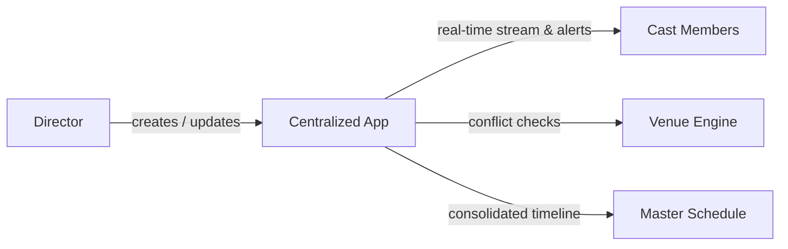

# Problem Analysis

This document analyzes the problem defined in [problem-statement.md](problem-statement.md), outlines the core requirements, and details how the implemented Flutter and Firebase solution addresses each problem. All core MVP requirements have been implemented and verified with automated test suites.

## Terminology

| Term | Meaning in this project |
|---|---|
| Production | A single theatre show being prepared by the group |
| Audition | A session in which candidates are considered for a production |
| Cast member | A person assigned to a production or character role |
| Director | A person responsible for directing and scheduling one or more productions |
| Rehearsal | A scheduled session for a production at a venue |
| Venue | A location that can host auditions or rehearsals |
| Commitment | A time-bound obligation of a person or venue, such as a rehearsal or audition |

## Problem Overview

The theatre group runs several productions in parallel. Each production needs auditions, a cast, rehearsals, and venue time. Group chats are the only coordination mechanism, and they do not scale to multiple productions. This leads to missed schedule changes, double-booked venues, and no consolidated director view.

## Current vs. Implemented Workflow

1. **Production Management**: Directors create and track productions with real-time Firestore synchronization.
2. **Auditions & Casting**: Audition notices and slots are published; directors assign actors to character roles with duplicate-role safeguards.
3. **Rehearsal Scheduling & Venues**: Rehearsals are scheduled at specific venues, with automatic detection of overlapping rehearsal or audition bookings.
4. **Master Schedule & Personal Commitments**: Directors have a consolidated multi-production timeline; cast members see their assigned production schedules.
5. **Real-time Notifications**: Schedule changes trigger in-app alerts and notifications with read status tracking.

## Core Requirements & Implementation Status

| ID | Requirement | Module | Priority | Status |
|---|---|---|---|---|
| R1 | Users can sign in and are identified as a director or cast member. | Authentication | Must | Implemented (`AuthService`, `UserService`, `LoginScreen`) |
| R2 | Directors can create and manage productions. | Production Management | Must | Implemented (`ProductionService`, `ProductionsScreen`) |
| R3 | Directors can record auditions for a production. | Audition Management | Must | Implemented (`AuditionService`, `AuditionsScreen`) |
| R4 | Directors can assign cast members to a production. | Cast Management | Must | Implemented (`CastService`, `CastScreen`, `AssignCastScreen`) |
| R5 | Directors can schedule rehearsals for a production at a venue. | Rehearsal Scheduling | Must | Implemented (`RehearsalService`, `RehearsalsScreen`) |
| R6 | Directors can maintain a list of venues. | Venue Management | Must | Implemented (`VenueService`, `VenuesScreen`, `AddEditVenueScreen`) |
| R7 | The system checks venue availability and prevents or flags overlapping bookings. | Venue Management | Must | Implemented (`VenueService.checkConflicts`) |
| R8 | Cast members can view their own upcoming commitments. | Master Schedule | Must | Implemented (`ScheduleService`, `MasterScheduleScreen`) |
| R9 | Directors can view commitments across all productions in one place. | Master Schedule | Must | Implemented (`MasterScheduleScreen`, chronological feed) |
| R10 | Affected cast members are notified when a schedule changes. | Notifications | Must | Implemented (`NotificationService`, `NotificationsScreen`) |
| R11 | The system flags when an actor or venue has overlapping commitments. | Schedule / Venues | Should | Implemented (Venue conflict checking & schedule aggregation) |

## Functional Areas

| Module | Responsibility | Implementation |
|---|---|---|
| Production Management | Records and status of productions | `client/lib/features/productions/` |
| Audition Management | Audition sessions, casting notices, and requirements | `client/lib/features/auditions/` |
| Cast Management | Cast members, role assignments, understudies, and roster | `client/lib/features/cast/` |
| Rehearsal Scheduling | Rehearsal sessions with time, venue, run notes | `client/lib/features/rehearsals/` |
| Venue Management | Venue records, capacities, facilities, and conflict checks | `client/lib/features/venues/` |
| Master Schedule | Combined schedule views for cast members and directors | `client/lib/features/schedules/` |
| Notifications | Delivering schedule change notifications and announcements | `client/lib/features/notifications/` |

## Implemented MVP Scope

The completed MVP covers all critical capabilities required to address the three core problems:

- **Role-based Authentication**: Director and Cast Member role distinction (R1).
- **Core Entity Management**: Complete CRUD and Firestore streams for productions, auditions, cast assignments, venues, and rehearsals (R2-R6).
- **Venue Conflict Detection**: Automated query of overlapping rehearsal and audition time windows at the chosen venue (R7).
- **Consolidated Master Schedule**: Cross-production calendar view for directors, with role-based filtering for cast members (R8, R9).
- **Notification Engine**: Targeted in-app alerts and FCM token registration for schedule changes and casting notices (R10).

## Problem-to-Solution Mapping

| Problem | Implemented System Solution | Modules |
|---|---|---|
| Missed schedule changes | Centralized real-time schedule feed & automated schedule-change notifications | Rehearsal Scheduling, Master Schedule, Notifications |
| Venue double-booking | Automated venue availability and conflict checking across rehearsals and auditions | Venue Management, Rehearsal Scheduling |
| No consolidated director view | Master Schedule aggregating all events chronologically across productions | Master Schedule, Production Management |

All responses have been fully implemented in Flutter, backed by Cloud Firestore with hardened security rules, and verified by 186 automated tests.
