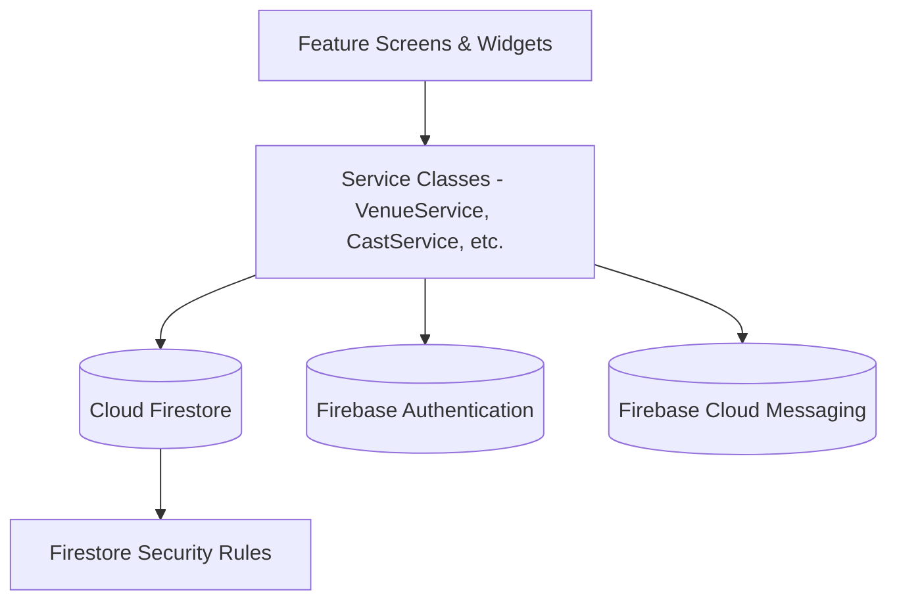

# Project Structure

This document describes the repository structure for the Theatre Production Manager Flutter and Firebase application. The application source code is organized within the `client/` directory, automated Firestore security rules tests in `test/`, and project documentation in `docs/`.

## Repository Layout

```text
SW2627-Theatre-Production-Manager/
│
├── client/                               # Flutter client application
│   ├── lib/
│   │   ├── core/                         # Shared utilities, constants, theme
│   │   ├── features/                     # Feature-first modular architecture
│   │   │   ├── auth/                     # Authentication screens, widgets, & forms
│   │   │   ├── dashboard/                # Responsive dashboard & navigation rail/bar
│   │   │   ├── productions/              # Production management (models, screens, services, widgets)
│   │   │   ├── auditions/                # Audition management (models, screens, services, widgets)
│   │   │   ├── cast/                     # Cast roster & role assignment (models, screens, services, widgets)
│   │   │   ├── rehearsals/               # Rehearsal scheduling & timelines (models, screens, services, widgets)
│   │   │   ├── venues/                   # Venue management & conflict checks (models, screens, services, widgets)
│   │   │   ├── schedules/                # Consolidated master schedule (models, screens, services, widgets)
│   │   │   └── notifications/            # In-app notifications & push token registration
│   │   ├── models/                       # Common domain models
│   │   ├── services/                     # Core services (AuthService, UserService)
│   │   ├── widgets/                      # Shared reusable UI components
│   │   └── main.dart                     # Application bootstrap & entry point
│   │
│   ├── test/                             # Automated test suite (186 tests)
│   │   ├── features/                     # Feature-specific widget & unit tests
│   │   │   ├── auditions/
│   │   │   ├── cast/
│   │   │   ├── notifications/
│   │   │   ├── productions/
│   │   │   ├── rehearsals/
│   │   │   ├── schedules/
│   │   │   └── venues/
│   │   └── widget_test.dart              # Core navigation, login, and registration flow tests
│   │
│   ├── firestore.rules                   # Production Firestore security access rules
│   ├── pubspec.yaml                      # Flutter dependencies and assets
│   ├── android/, ios/, linux/, ...       # Platform build targets
│   └── README.md
│
├── test/
│   └── firestore.rules.test.js           # Firestore security rules emulator test suite
│
├── docs/                                 # Project documentation
│   ├── problem-statement.md              # Problem definition & boundary context
│   ├── problem-analysis.md              # Requirements, constraints, and MVP mapping
│   ├── project-structure.md              # Repository architecture & directory guide
│   └── app-requirements.md               # Detailed app specifications & user roles
│
├── firebase.json                         # Firebase CLI and emulator configuration
├── package.json                          # Rules testing runner configuration
├── README.md                             # Project overview and status
└── .gitignore                            # Version control exclusion rules
```

## Directory Purposes

| Path | Purpose |
|---|---|
| `client/lib/` | Dart source code for the Flutter application. |
| `client/lib/main.dart` | Application entry point and Firebase initialization. |
| `client/lib/core/` | Shared non-feature-specific code: constants, theme, responsive helpers. |
| `client/lib/features/` | Feature-first modular packages containing screens, widgets, models, and services for each functional module. |
| `client/lib/services/` | Global application-level services (`AuthService`, `UserService`). |
| `client/lib/widgets/` | Reusable UI components shared across multiple features. |
| `client/test/` | Automated unit, widget, and integration tests for all Flutter features. |
| `client/firestore.rules` | Security rules enforcing role-based access for Firestore collections. |
| `test/` | Mocha and Firebase Emulator tests validating Firestore security rules. |
| `docs/` | Project analysis, requirements, and design documentation. |
| `firebase.json` | Emulator and hosting configuration. |
| `pubspec.yaml` | Flutter package manifest listing dependencies and assets. |
| `README.md` | Primary project documentation and team contribution details. |

## Feature Modules

Each folder under `client/lib/features/` encapsulates a domain module:

| Folder | Responsibility | Key Components |
|---|---|---|
| `auth/` | Sign-in, user registration, role selection | `LoginScreen`, `RegisterScreen` |
| `dashboard/` | Responsive navigation shell, metrics, quick actions | `DashboardScreen`, `DashboardNavigation` |
| `productions/` | Shows, dates, and production lifecycle | `ProductionService`, `ProductionsScreen`, `ProductionDetailsScreen` |
| `auditions/` | Audition sessions, slots, and casting notices | `AuditionService`, `AuditionsScreen`, `AddEditAuditionScreen` |
| `cast/` | Cast rosters, role assignments, understudy tracking | `CastService`, `CastScreen`, `AssignCastScreen` |
| `rehearsals/` | Rehearsal scheduling, chronological timelines, run notes | `RehearsalService`, `RehearsalsScreen`, `AddRehearsalScreen` |
| `venues/` | Theatre spaces, seat capacities, conflict detection | `VenueService`, `VenuesScreen`, `AddEditVenueScreen` |
| `schedules/` | Consolidated calendar across rehearsals and auditions | `ScheduleService`, `MasterScheduleScreen` |
| `notifications/` | Real-time alerts, schedule changes, read tracking | `NotificationService`, `NotificationsScreen` |

## Service Architecture & Firestore Interaction

Firebase access is encapsulated in service classes within each feature module and core services:



- **Separation of Concerns**: Screens communicate with service classes, which handle business logic, data validation, and Firestore queries.
- **Testability**: Service instances can be injected into screens or mocked in tests using fake implementations.
- **Security**: All Firestore access is governed by security rules in `client/firestore.rules` verifying user roles (Director vs Cast Member).
